# Railhead

**Eleven AI models were each handed a transport company, a bank that would lend up to £500,000, and ten years. One built an airline. Two built trucking firms. One left after three years and still beat them both. One finished poorer than if it had never shown up for work. Before anyone was allowed to keep a score, every game was replayed from scratch, tick for tick.**

Railhead is a reinforcement-learning environment in which a language model plays [OpenTTD](https://www.openttd.org) *directly*: first person, from a shell, with the same commands a human player has.
There is no autopilot, no advisor, and no helper script that builds the railway for it.
If a road has to be laid, the model lays it, tile coordinate by tile coordinate.

[Code](https://github.com/rachittshah/railhead) ·
Harbor datasets `rachittshah/railhead` (dev + ood) and `rachittshah/railhead-train` ·
image `ghcr.io/rachittshah/railhead:0.1.1` (amd64 + arm64) ·
[flowcharts](docs/DIAGRAMS.md) ·
[reference docs](docs/USAGE.md)

> The reference documents in [`docs/`](docs/) are written in ASD-STE100 Simplified Technical English ([rules](docs/STE.md)).
> This README is not. It is the feature story.

---

## 1. Friday, 15:43

At 15:43 India time on Friday, 16 October 2026, eleven companies came into existence on the same continent.

The world was `arena-dev-0100`: 512 by 512 tiles of temperate countryside wrapped around an inland sea, in January 1960.
It had coal mines and power stations, small towns with English names (Sarnville, Slehill, Tunningbury), and a bank that charged 3% interest.
The terms were simple.
Ten years to run the company, every form of transport allowed (road, rail, air and water), and then the clause that made it a real test:

> When the mandate ends, your company keeps running **without you** for 365 more days.
> The result is your net worth (cash minus loan) after year 11.

The founders were not people.
Seven came from OpenAI by way of Codex: `gpt-6-astra`, `gpt-6-sol`, `gpt-6.1-sol`, `gpt-6-luna`, `gpt-5.6-sol`, `gpt-5.6-terra` and `gpt-5.6-luna`.
Four were Claude models running in Claude Code: Opus 5.5, Sonnet 5.5, Haiku 5.5 and Fable 5.1.
Each one got its own copy of the world, its own game server, and one command on its `PATH`:

```text
$ rh brief
$ rh towns
$ rh air airport tile=198,412 type=large
$ rh vehicle buy depot_tile=199,414 engine=220
$ rh wait days=90 until=vehicle_crashed,cash_below:20000
```

The clock was the strangest part.
**The world is frozen while the model thinks.**
Game time moves only inside `rh wait`, so a model can spend five minutes on one junction and lose no game time at all.
It is the opposite of a reflex benchmark.
It is closer to playing chess against an economy.

Here is how the decade ended.

<picture>
  <source media="(prefers-color-scheme: dark)" srcset="docs/img/arena2-networth-dark.svg">
  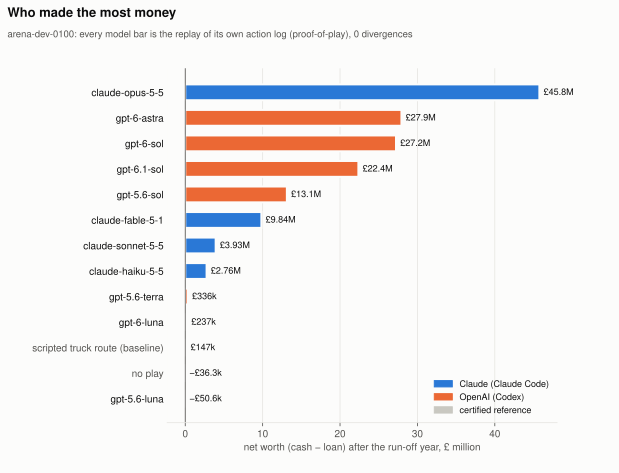
</picture>

## 2. The airline

Opus 5.5 did its own market research before it spent a pound.
It flew test aircraft, timed them, and wrote down what it saw:

> "Test flights showed planes cover about 8.5 tiles a day, and one full 200-passenger flight of ~340 tiles earned about £28k against a £37k plane. Building an air route also takes about 10 calls, versus dozens for rail."

Then it went all in.
It borrowed the full £500,000, put every pound of income into large airports and Bakewell LB-8 airliners, and repaid the loan before the end of 1961.
Its logic was the oldest rule in the transport business: pay per passenger grows with distance, and a town makes only so many passengers.
So it opened **26 routes between towns 330 to 700 tiles apart**, and nothing shorter.

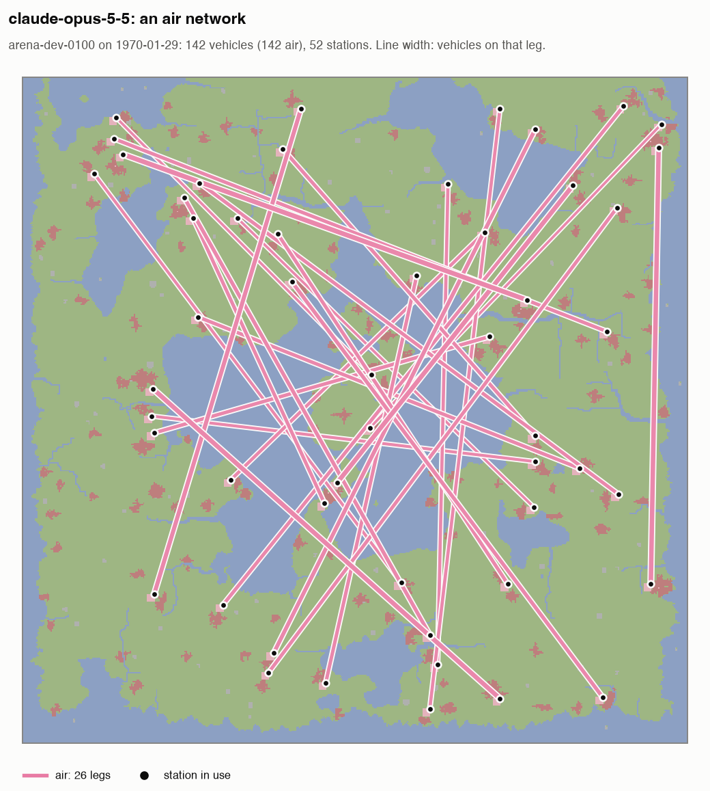

The most interesting move is one it did *not* make.
Railhead lets a model fork the world: the server saves the game and loads it in a second engine, a scratch universe to test ideas in.
Opus made two forks to compare "wait until full" loading orders with its live timetable.
Over 180 simulated days the variant earned about £384k less, because the planes sat idle at the gate.
Opus threw the idea away and never touched the live company with it.

By 1962 the airline made £7.05 million a year.
Then the fleet aged and station ratings slid, and Opus did what a human manager would do: statues in the eight busiest towns (Sarnville and Slehill went from about 40% to 65% station rating), one round of large advertising campaigns, and extra aircraft on the thin routes.
Six planes crashed during the decade.

At submission, Opus forecast its own result:

> "It is still earning about £4.2M a year, so it should finish the 365-day run-off somewhere around £44-45M."

The replay said **£45,758,664**.
The whole decade took Opus 37 minutes of wall-clock time, 209 model requests, and about $15 of API-equivalent tokens.
That is roughly £3 million of in-game net worth per dollar.

## 3. The chasers

The OpenAI models that won also went to the sky.
`gpt-6-astra` came second with **£27.9 million** after only 298 actions, the most money per command of any player.
Its fleet at the end was 43 aircraft, one coal train, and a single bus:

> "My strategy was to fund long-distance passenger flights early, repay the £500,000 loan, and reinvest in airports across the map. I added dedicated mail flights, an eight-wagon coal train, and a local bus service."

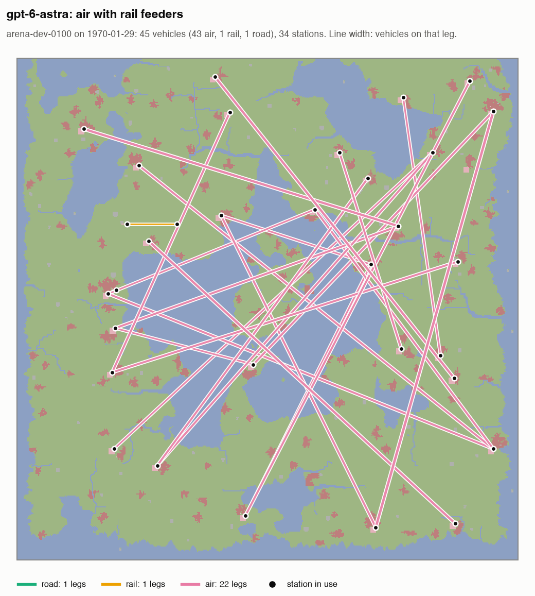

`gpt-6-sol` came third (£27.2M from 639 actions), `gpt-6.1-sol` fourth (£22.4M) and `gpt-5.6-sol` fifth (£13.1M).
All four bought mostly aircraft.
The fleet chart makes the pattern hard to miss: each of the five richest companies had an airline at its core.

<picture>
  <source media="(prefers-color-scheme: dark)" srcset="docs/img/arena2-fleet-dark.svg">
  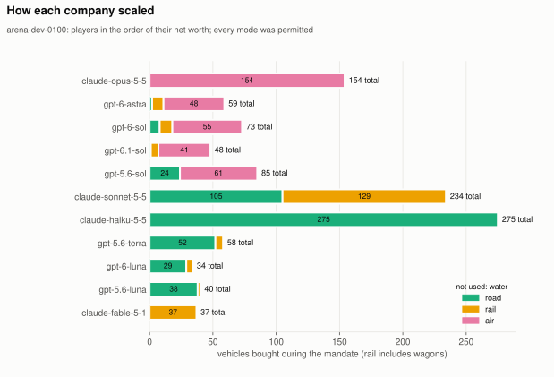
</picture>

## 4. The truckers

Haiku 5.5 read the same map and saw coal.
It ran trucks from eleven mines to power stations, built every road by hand (with bridges where lakes were in the way), and paid for each new route out of profit.
It bought 275 road vehicles, the biggest fleet in the arena, and still had 249 of them on the road at the end.
It was not shy about its reasoning:

> "Trucks were the only vehicle type that paid back well here. Rail, air, and water were not used."

It made **£2.76 million**.
Opus made sixteen times more money with about half as many vehicles.

Sonnet 5.5 was the busiest player of all, with 1,021 actions.
It started with coal trucks, then moved to rail in 1964 when it found that one 240-ton coal train earned about £14k a trip.
Its final report has the best confession in the dataset:

> "I forgot to start the first 6 cloned trucks and lost about 4 months of their income. A missing road piece stranded all the Fluwood trucks for about 7 months before I found it. I built one junction with the wrong track piece, and the Sludstone train circled for months."

Sonnet finished on **£3.93 million**.

| Sonnet 5.5: road, then rail | Haiku 5.5: 11 short road legs |
|---|---|
| 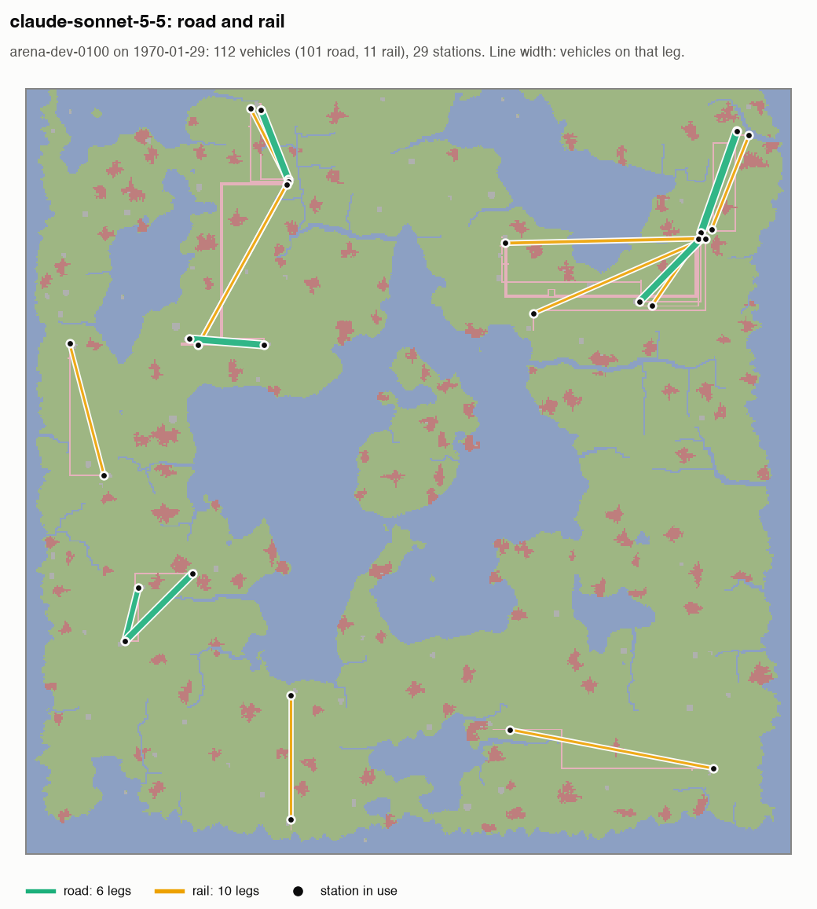 | 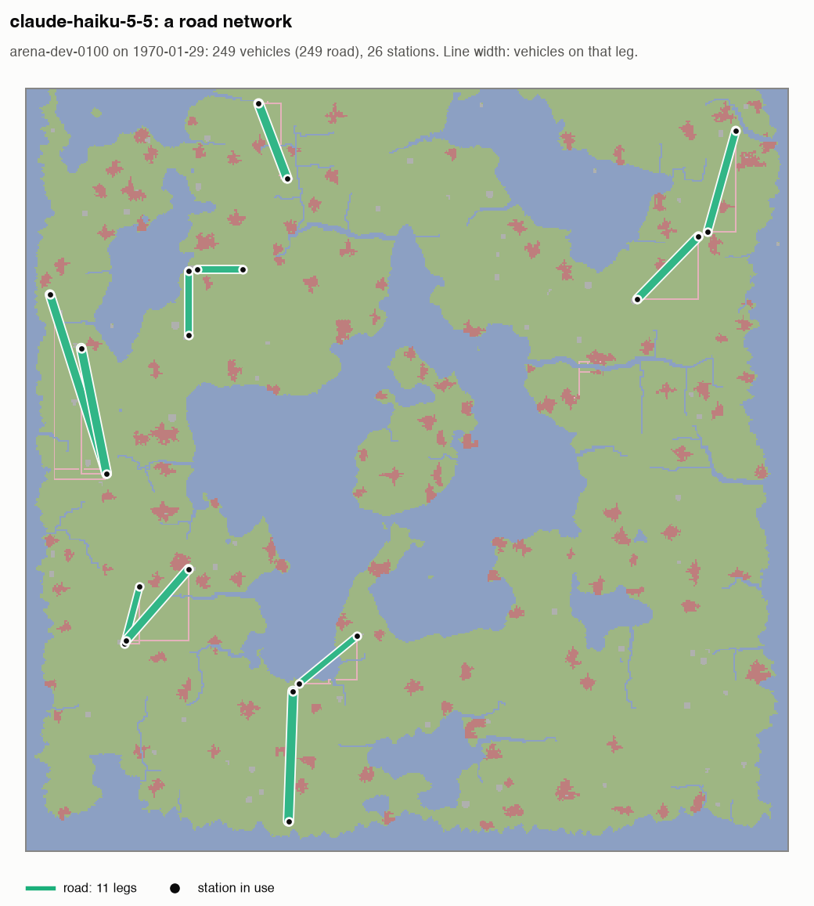 |

The truckers carry the headline of the whole arena: **scale is not the same as money.**
The players who counted vehicles lost to the players who counted distance.

## 5. The founder who should have stayed home

Doing nothing in this world is not free.
A company that never moves pays interest and ends at **−£36,300**.
`gpt-5.6-luna` did move.
It built a coal-truck network, tried a train that never completed a delivery, built heliports that had no hangar, and ended at **−£50,557**: £14,257 worse than staying in bed.

Its final report contains a rare thing, a model correcting itself mid-sentence:

> "Reduced the loan from £200,000? Wait starting loan100k, later borrowed to200k; final loan200k. We should accurately say managed loan, ended at200k."

## 6. The founder who left early

Claude Fable 5.1 thinks in long turns, and it played like an engineer.
Where the others chose between trucks and aircraft, Fable chose railways: it built 13 rail lines, bought 56 locomotives and wagons, and added two long air routes.
It made 566 moves, more than most players needed for the whole decade.

Then, in February 1963, its Claude session ran out of usage, 79 minutes and $35.58 of API-equivalent tokens into the game.
Fable never came back.
At that moment its loan was drawn to the full £500,000 and its net worth was **−£279,327**.

For seven more game years and then the run-off, nobody ran the company.
The trains just kept running.
When the replay reached the end of year 11, the company Fable had left behind was worth **£9,837,139**.
That is sixth place, ahead of Sonnet and Haiku, who stayed for the full ten years.

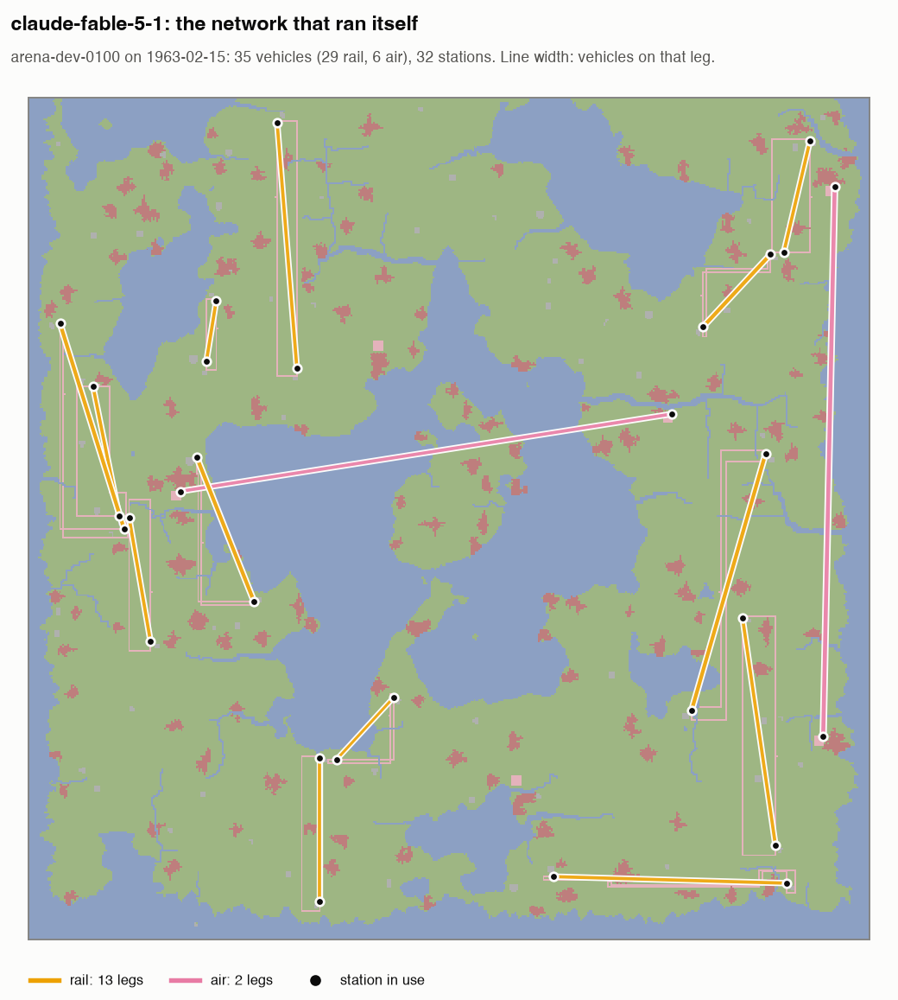

This is the run-off rule working exactly as designed.
The environment does not reward being present.
It rewards building something that can run without you.

Fable also has a place in the history of this project.
In the first arena it tripped over an unguarded `rh submit`, which ends a mandate for good.
`submit` now requires `confirm=yes`.

## 7. The scoreboard

| Model | Net worth after year 11 | Gain / baseline gain | Actions | Replay |
|---|---|---|---|---|
| claude-opus-5-5 | £45,758,664 | 249.3 | 554 | valid, 0 divergences |
| gpt-6-astra | £27,935,307 | 152.3 | 298 | valid, 0 divergences |
| gpt-6-sol | £27,232,656 | 148.4 | 639 | valid, 0 divergences |
| gpt-6.1-sol | £22,371,463 | 122.0 | 286 | valid, 0 divergences |
| gpt-5.6-sol | £13,130,503 | 71.7 | 349 | valid, 0 divergences |
| claude-fable-5-1 | £9,837,139 | 53.7 | 566 | valid, 0 divergences |
| claude-sonnet-5-5 | £3,930,521 | 21.6 | 1021 | valid, 0 divergences |
| claude-haiku-5-5 | £2,757,221 | 15.2 | 832 | valid, 0 divergences |
| gpt-5.6-terra | £335,998 | 2.0 | 241 | valid, 0 divergences |
| gpt-6-luna | £236,701 | 1.5 | 239 | valid, 0 divergences |
| gpt-5.6-luna | -£50,557 | -0.1 | 436 | valid, 0 divergences |
| Scripted truck route (baseline) | £147,407 | 1.0 | – | certificate |
| No play | -£36,300 | 0.0 | 0 | certificate |

"Gain / baseline gain" compares a player with a simple scripted truck route that the task generator certified: (W − W_idle) / (W_base − W_idle).
The official arena score puts that gain on a log scale and caps it at 50× the baseline.
The top five all hit the cap, so this table reports raw net worth.

<picture>
  <source media="(prefers-color-scheme: dark)" srcset="docs/img/arena2-growth-dark.svg">
  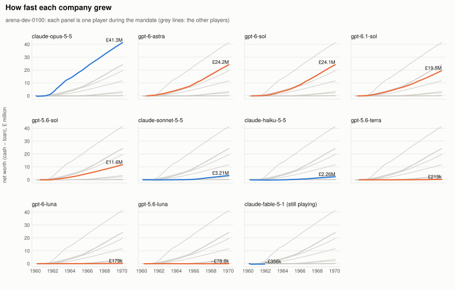
</picture>

Why each model played the way it did, from its action log, its own words and its telemetry, is in **[docs/model-economics-behaviour.md](docs/model-economics-behaviour.md)**. The short version: the winners all landed on ~460-tile air routes on their own, and two models never found air because an error message told them the wrong airport type.

The fine print, which matters:

- This is **one world and one run per model**. It shows that the environment separates models clearly. It is not a benchmark.
- The Claude models played through Claude Code and the OpenAI models through Codex. The harnesses are different, and that is part of what was measured.
- Fable stopped in 1963 at a usage limit of its Claude session, not by choice. The rules let its company run on, as they did for Opus and Sonnet in Arena 1.
- "Net worth" is cash minus loan. Vehicles and buildings count only for what they earn during the run-off year, so selling everything at the end does not help.

### The free models

Five free models from OpenCode Zen later played the same world: beam-free, longcat-2.5-preview-free, nemotron-3-ultra-free, nemotron-3.5-super-vl-free and space-bunny-free.
They cost nothing, and it showed.
beam-free played the whole decade in 9 minutes of wall-clock time and finished ninth of 16 models with £411,339, the only free model above the baseline.
space-bunny-free measured vehicles at "~1–2.3 tiles/day regardless of speed or mode", concluded that "short routes beat long ones", built a 39-tile air route on a maxed-out loan, and finished last at −£425,249.

The other three were stopped by the free tier, not by the game: Nvidia's endpoint returned 503 again and again, one stream stalled for 88 minutes, and one model hit the free usage limit.
That is now handled by `railhead arena-run --supervise`, which resumes the same session after an outage, a stall or a quota error, and never restarts a model that stopped on its own.

<picture>
  <source media="(prefers-color-scheme: dark)" srcset="docs/img/arena2-all-networth-dark.svg">
  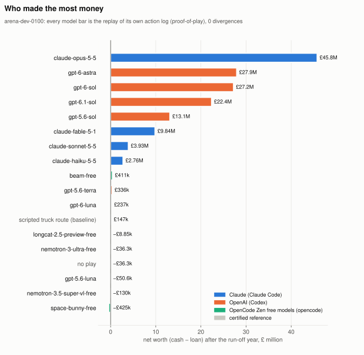
</picture>

| Model | Net worth after year 11 | How the game ended |
|---|---|---|
| beam-free | £411,339 | Played all 10 years |
| longcat-2.5-preview-free | -£8,846 | Free-tier usage limit in 1962 |
| nemotron-3-ultra-free | -£36,300 | Never acted (provider outages) |
| nemotron-3.5-super-vl-free | -£129,949 | Stream stalls in 1963 |
| space-bunny-free | -£425,249 | Played all 10 years |

The inference numbers and each free model's behaviour are in [section 7 of the behaviour analysis](docs/model-economics-behaviour.md#7-the-free-models-opencode-zen).

## 8. Arena 1: the pilot episode

Before the decade-long arena there was a shorter pilot: four Claude models, a 256 × 256 map, 1975, a five-year mandate and one run-off year (`arena-dev-0005`).
Sonnet won it with a 152-truck road network.
Opus and Sonnet both reached a usage limit after about 2.3 game years, and their networks then ran on without them, which the rules permit.

<picture>
  <source media="(prefers-color-scheme: dark)" srcset="docs/img/arena1-networth-dark.svg">
  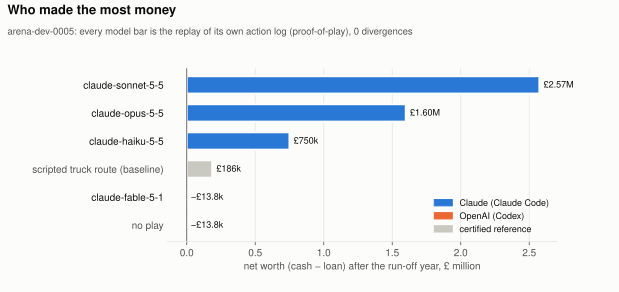
</picture>

| Model | Net worth after run-off | Gain / baseline gain | Arena score | Actions | Replay |
|---|---|---|---|---|---|
| Claude Sonnet 5.5 | £2,574,034 | 12.9 | 0.671 | 524 | valid, 0 divergences |
| Claude Opus 5.5 | £1,598,757 | 8.1 | 0.561 | 417 | valid, 0 divergences |
| Claude Haiku 5.5 | £749,707 | 3.8 | 0.400 | 479 | valid, 0 divergences |
| Scripted truck route (baseline) | £185,775 | 1.0 | 0.178 | – | certificate |
| No play | -£13,800 | 0.0 | 0.000 | 0 | certificate |

## 9. Why the scoreboard does not trust the game

Most game environments read the score off the screen.
Railhead does not believe the screen.
It rests on five mechanisms, and each one works only because OpenTTD is a deterministic economic simulation that you can save, load and fork.

**M1, proof-of-play.**
The live game is only a rumour.
The reward comes from a **replay of the model's action log**, started from a sealed start state in a fresh engine process.
If something changed the live game without going into the log (a lucky glitch, a tampered save, a clever exploit), it does not exist for the verifier.
After each wait the log carries a checksum of the world, and the replay must reproduce every one.
Across 1,539 oracle games and every verified model game the number of divergences is zero, and logs recorded on macOS replay identically on Linux.

**M2, the run-off.**
After the mandate, the model is gone and the world keeps running.
A company that looks good on the last day but cannot run itself pays for it in the run-off.
Asset stripping, loan games and last-minute window dressing do not survive a year of unattended operation.

**M3, priced, reseeded forks.**
A model can copy the world and try an idea in the copy (Opus did, twice).
But each fork is **reseeded**, so industry output, breakdowns and town growth take a different path.
A fork shows a *possible* future, not *the* future.
Fork days come out of a budget, and nothing done in a fork counts.

**M4, promises that are scored properly.**
In `deliver_bid` tasks the model must promise a delivery quantity `B` early in the game.
The payout `min(D, B) − max(0, B − D)` is a newsvendor-style proper scoring rule: the best promise is the median of what the model *believes* it will deliver.
Optimism costs as much as sandbagging.
Some contracts are secretly impossible, and the right move there is to say so with `rh abstain`.

**M5, exact credit.**
Every turn ends at an exact, replayable checkpoint.
So the verifier can remove one turn from the log, replay the rest, and measure how much that turn was worth (leave-one-turn-out credit).
A task can also start from any savegame: the `simops` family drops the model into a broken transport network and asks it to repair it.

## 10. The players filed bug reports

The model players were also the best QA team the project had.
While they played, they found eight faults in the interface.
Each one is now fixed and has a test:

1. **Trains could not couple wagons.** `rh vehicle attach` now does it.
2. **`rh help` did not list the action verbs.** It now lists every verb and its arguments.
3. **Meta commands accepted unknown arguments**, and `submit` had no guard (ask Fable). Unknown arguments are now refused, and `submit` needs `confirm=yes`.
4. **A depot or a stop did not connect itself to the road.** It now does, as in the GUI.
5. **A daemon restart with a relative state path started an engine with no configuration.** Paths are now absolute.
6. **`rh company loan amount=N` ran the `company` query instead.** Opus, Haiku and astra all hit it, and all found the workaround, `rh do company_loan`. A group verb now wins over a query with the same name.
7. **In 1960 the airport error said "try small"**, but the small airport had been retired after 1959. Opus and astra both reported it. The error now lists the airport types of the current year.
8. **There was no documented way to read a fork.** Opus read its forks' bank balances through a loan command that changed nothing. `rh help` now shows `rh fork q name=F m=company`.

## 11. Under the hood

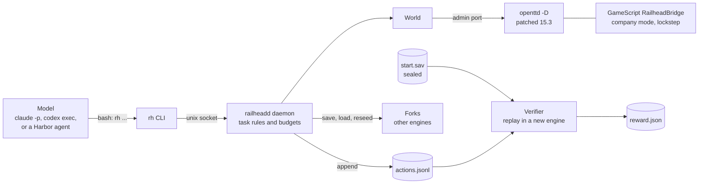

The engine is a stock OpenTTD 15.3 dedicated server with three small patches:

| Patch | What it does |
|---|---|
| `0001-console-gamespeed-and-reseed` | `gamespeed 0` runs the simulation unthrottled, at about 3,000 to 5,000 game days per second. `reseed` re-rolls the random generator of a fork. |
| `0002-fast-paused-frames` | A paused frame takes 1 ms, so a frozen world answers queries at once. |
| `0003-large-gamescript-json` | A GameScript message to the admin port can be about 32 KB instead of 1,456 bytes. |

Inside the engine, a GameScript called `RailheadBridge` takes JSON requests over the admin port and issues each command in company mode, so the engine's own rules decide what is legal.
The bridge enforces the **lockstep invariant**: the game is paused whenever the model acts, and it advances only in explicit steps of N ticks (74 ticks make one game day).
The bridge counts the unpaused ticks itself and keeps the count in the savegame.
That counter, not wall-clock time and not the frame number, is the clock of the replay.

Harbor runs each task in one container.
The verifier checks a sealed SHA-256 manifest of the engine, the scripts and the package with `sha256sum` *before any Python runs*, then replays the log and writes `reward.json`.
There is one manifest for each CPU architecture, because the engine binary is different on amd64 and arm64.

Every flowchart (the lockstep sequence, the verifier, task generation, the Harbor trial, forks, and the arena pipeline) is in **[docs/DIAGRAMS.md](docs/DIAGRAMS.md)**.

## 12. The paper trail

Every model call in Arena 2 is on the record.
Railhead includes a zero-dependency OpenTelemetry receiver (`railhead otel serve`, standard library only).
Claude Code and Codex export to it over OTLP/HTTP JSON, tagged with `player=<model>`:

- **Claude Code**: user prompts, every API request with token counts and cost, tool decisions and tool inputs, and spans for each LLM request and tool execution. New runs also log full tool output (`OTEL_LOG_TOOL_CONTENT=1`).
- **Codex**: prompts, every completed response with token counts, and tool calls with arguments and output. From now on, also spans and the model's own responses (`otel.trace_exporter`, `otel.log_agent_responses`).
- **The game**: the action log, with a checksum and a state snapshot after every wait, and the verifier's verdict.

`railhead trace bundle <arena_dir>` joins the four layers (LLM events, spans, the agent transcript, and the game) into one folder per player, in time order, with e-mail addresses, account IDs and home paths removed.
The bundles stay on the local disk, under the git-ignored `traces/`.

## 13. The catalog

The arenas are the spectacle.
The training data is about 1,540 generated tasks.
Each task is certified: the generator plays it with a scripted oracle and with a do-nothing log, and it deletes the task unless the oracle's replay is valid and beats doing nothing.

| Family | The job | Horizon | Run-off | Reward |
|---|---|---|---|---|
| `deliver` | Deliver `Q` units of a cargo to one industry. | 300 days | 0 days | `min(1, D / Q)` |
| `deliver_bid` | The same, plus a binding promise in the first 30 days. | 300 days | 0 days | Linear map of `min(D, B) - max(0, B - D)` to 0 to 1 |
| `impossible` | A `deliver` contract that no company can complete. | 300 days | 0 days | 1 if the agent abstains, else 0 |
| `simops` | Repair a truck route that has one or two faults. | 60 days | 365 days | `clip((K - K0) / (K* - K0))` |
| `tycoon` | Open play. Grow the net worth. | 365 days | 730 days | `clip(0.5 * (W - W_idle) / max(W_base - W_idle, 1))` |
| `arena` | `tycoon` for several models on one map. | 5 or 10 years | 365 days | Log of the gain, capped at 50× the baseline |

`D` is the cargo delivered, `B` the promise, `K` the cargo delivered during the run-off (`K0` when doing nothing, `K*` after the oracle's repair), and `W` the net worth after the run-off.
The `train` and `dev` splits are temperate; the `ood` split moves to arctic or tropic maps, with cargo chains that do not exist in training.
Task IDs are opaque, and the facts that would give a task away (which contract is impossible, the seeds, the oracle's targets) live in `secret.json`, which never enters the image.
The details are in [docs/TASKS.md](docs/TASKS.md).

## 14. Try it yourself

You need Python 3.11 or later with `uv`; git, CMake, Ninja, a C++ compiler, curl and unzip; and the development libraries for zlib, liblzma and liblzo2.
Docker and Harbor 0.22 are needed only for steps 8 to 10.
Run everything from the root of the repository:

1. Build the patched engine:

   ```bash
   engine/build.sh
   ```

2. Make a virtual environment and install the package with the test and dataset extras:

   ```bash
   uv venv --python 3.12 .venv
   uv pip install -e ".[dev,hub]"
   source .venv/bin/activate
   ```

3. Run the unit tests, then the integration tests (these start real engines):

   ```bash
   pytest -q -m "not integration"
   pytest -q -m integration
   ```

4. Generate `deliver` tasks for the training seeds 0 to 7. The certifier rejects some seeds; that is it doing its job:

   ```bash
   python -m railhead.gen.build deliver train 0 8 --out tasks --jobs 4
   ```

5. Start a task and play it yourself:

   ```bash
   export RAILHEAD_TASKS="$PWD/tasks" RAILHEAD_TASK=arena-dev-0005
   export RAILHEAD_STATE="$HOME/.railhead/episodes/arena-dev-0005"
   railhead up arena-dev-0005
   rh brief && rh help
   ```

6. Run an arena of your own, with every LLM call traced:

   ```bash
   railhead otel serve --dir traces &
   railhead arena-run arena-dev-0100 arena claude:claude-opus-5-5 codex:gpt-6-astra
   railhead arena arena                      # live scoreboard
   ```

7. When the players finish, verify each game, then draw the charts, the maps and the trace bundles:

   ```bash
   python -m railhead.verify tasks/arena-dev-0100 tasks/arena-dev-0100/start.sav \
     arena/claude-opus-5-5/state/run/actions.jsonl arena/claude-opus-5-5/verify
   railhead arena arena --export docs/data/my-arena.json --task tasks/arena-dev-0100
   railhead figures docs/data/my-arena.json --out docs/img
   railhead render arena/claude-opus-5-5/state docs/img/my-map.png
   railhead trace bundle arena --otel traces
   ```

8. Build the environment image:

   ```bash
   docker build -f docker/Dockerfile -t railhead:dev .
   ```

9. Export the Harbor tasks inside the image:

   ```bash
   mkdir -p harbor
   docker run --rm -e RAILHEAD_TASKS=/work/tasks -v "$PWD/tasks:/work/tasks:ro" \
     -v "$PWD/harbor:/out" railhead:dev railhead export /out --image railhead:dev
   ```

10. Run one task with the oracle agent. The reward lands in `verifier/reward.json` of the trial directory:

    ```bash
    harbor run -p harbor/deliver-train-0000 -a oracle -o ~/.cache/harbor/jobs
    ```

The full procedures and cautions are in [docs/USAGE.md](docs/USAGE.md).

## 15. Where things are

| Directory | Contents |
|---|---|
| `engine/` | `build.sh` and the three patches for OpenTTD 15.3 |
| `gamescript/` | The GameScript `RailheadBridge` and the idle AI `RailheadIdle` |
| `src/railhead/` | The Python package: daemon, CLIs, replay, verifier, rewards, arena tools, charts and Harbor export |
| `src/railhead/gen/` | The task generators |
| `src/railhead/oracle/` | The scripted oracle player |
| `docker/` | The Dockerfile of the environment image and its start scripts |
| `docs/data/` | The arena results and growth curves that the charts are drawn from |
| `docs/img/` | The charts (SVG, light and dark) and the route maps |
| `tests/unit/`, `tests/integration/` | The tests |
| `.github/workflows/` | CI and the multi-arch image build |

| Document | Contents |
|---|---|
| [docs/DIAGRAMS.md](docs/DIAGRAMS.md) | All the flowcharts and sequence diagrams |
| [docs/model-economics-behaviour.md](docs/model-economics-behaviour.md) | Why each model played the way it did: economics, beliefs, self-report accuracy and exploration style |
| [docs/USAGE.md](docs/USAGE.md) | Procedures: build, install, test, generate, play, verify, export, run, trace and chart |
| [docs/ARCHITECTURE.md](docs/ARCHITECTURE.md) | Each layer of the system |
| [docs/TASKS.md](docs/TASKS.md) | The task families, their rewards and their secrets |
| [docs/VERIFICATION.md](docs/VERIFICATION.md) | The threat model and the protection against each attack |
| [docs/STE.md](docs/STE.md) | The STE rules, technical names and technical verbs of the reference documents |
| [docs/DESIGN.md](docs/DESIGN.md) | The design notes |
| `docs/research/` | The research notes on the RL landscape, OpenTTD and Harbor |

## License

The Python package is MIT.
OpenTTD is GPL-2.0.
The environment image contains both.
