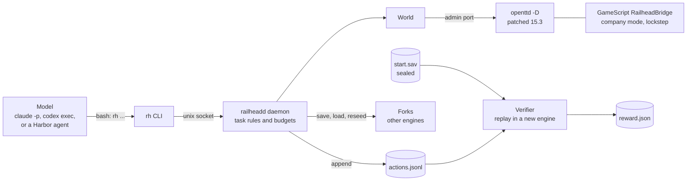
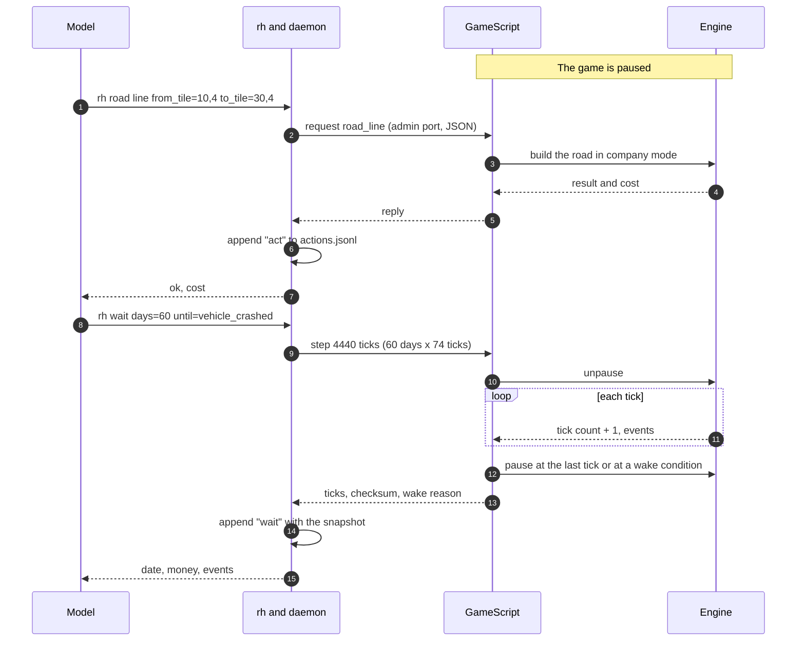
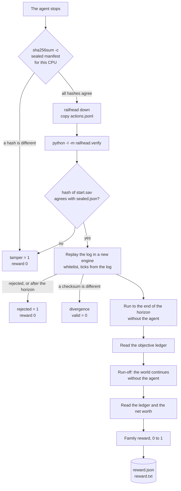
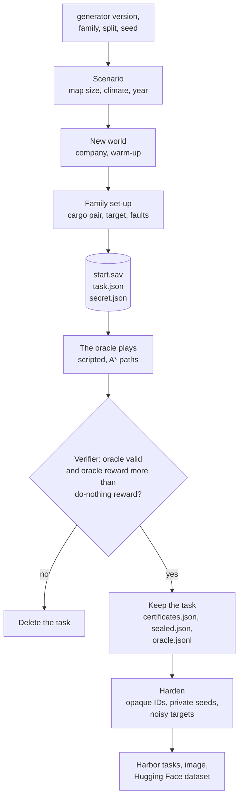
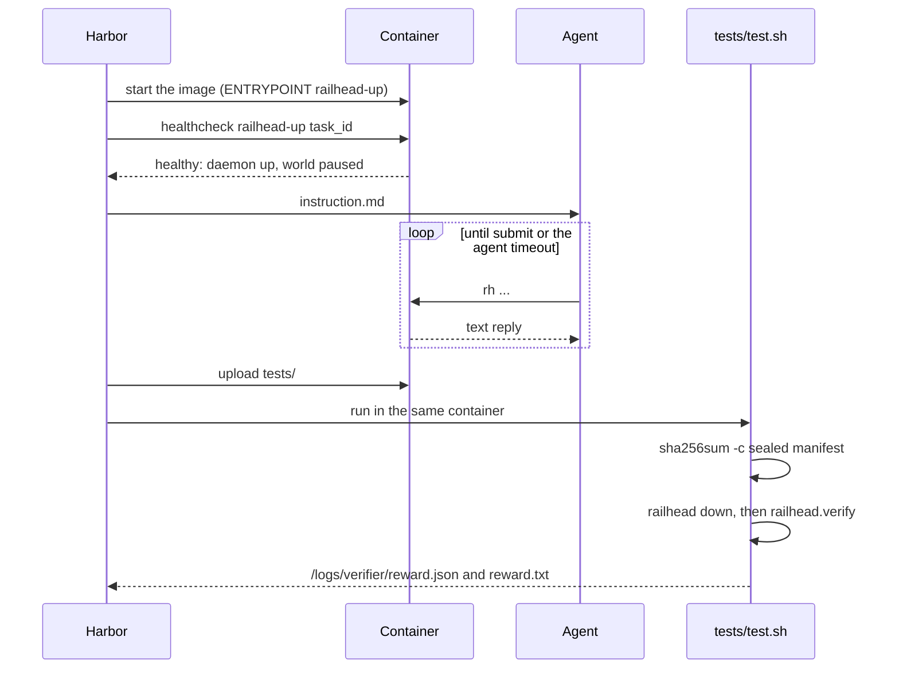
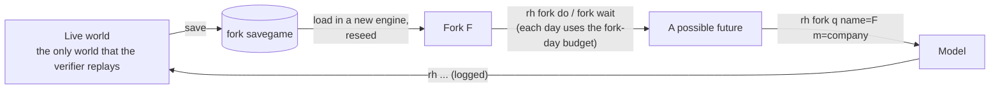
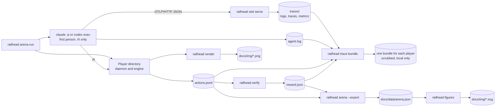

# Railhead diagrams

This document contains the flowcharts and the sequence diagrams of Railhead.
The text follows ASD-STE100. Refer to [STE.md](STE.md).
GitHub shows the diagrams from their Mermaid source.

| Number | Diagram | Related text |
|---|---|---|
| 1 | [System](#1-system) | [ARCHITECTURE.md, Overview](ARCHITECTURE.md#overview) |
| 2 | [One action and one wait (lockstep)](#2-one-action-and-one-wait-lockstep) | [ARCHITECTURE.md, 3.1](ARCHITECTURE.md#31-the-lockstep-invariant) |
| 3 | [Verifier](#3-verifier) | [VERIFICATION.md, 2](VERIFICATION.md#2-verifier-procedure) |
| 4 | [Task generation and certification](#4-task-generation-and-certification) | [TASKS.md, 1.5](TASKS.md#15-certificates) |
| 5 | [Harbor trial](#5-harbor-trial) | [ARCHITECTURE.md, 13.2](ARCHITECTURE.md#132-harbor-task) |
| 6 | [Forks](#6-forks) | [ARCHITECTURE.md, 9](ARCHITECTURE.md#9-forks) |
| 7 | [Arena, traces, and charts](#7-arena-traces-and-charts) | [USAGE.md, Run an arena](USAGE.md#run-an-arena) |

## 1. System

The model sends commands only to `rh`.
The daemon sends each command to the engine and records it in the action log.
The verifier reads only the sealed start state and the action log.

## 2. One action and one wait (lockstep)

The game is paused when the model acts.
Game time passes only during a step.
At the end of the step, the GameScript pauses the game again.
The daemon records the tick count, the checksum, and a snapshot after each wait.

## 3. Verifier

The verifier runs after the agent stops.
It examines the hashes before it runs Python code.
Then it replays the action log in a new engine and lets the world continue without the agent.

## 4. Task generation and certification

The generator makes a task from four values: the generator version, the family, the split, and the seed.
It keeps the task only if the oracle replay is valid and the oracle reward is more than the do-nothing reward.

## 5. Harbor trial

The agent and the verifier use the same container (shared mode).
Harbor uploads `tests/` only after the agent stops.

## 6. Forks

A fork is a copy of the world in a different engine process.
The daemon reseeds each fork. Because of this, a fork shows a possible future and does not show the true future.
Actions in a fork are not in the action log. They have no effect on the reward.

## 7. Arena, traces, and charts

An arena puts several players on the same task.
Each player has its own daemon, its own engine, and its own state directory.
The telemetry, the action log, and the verdict of each player go into one trace bundle.
The verified results go into `docs/data/` and then into the charts.

