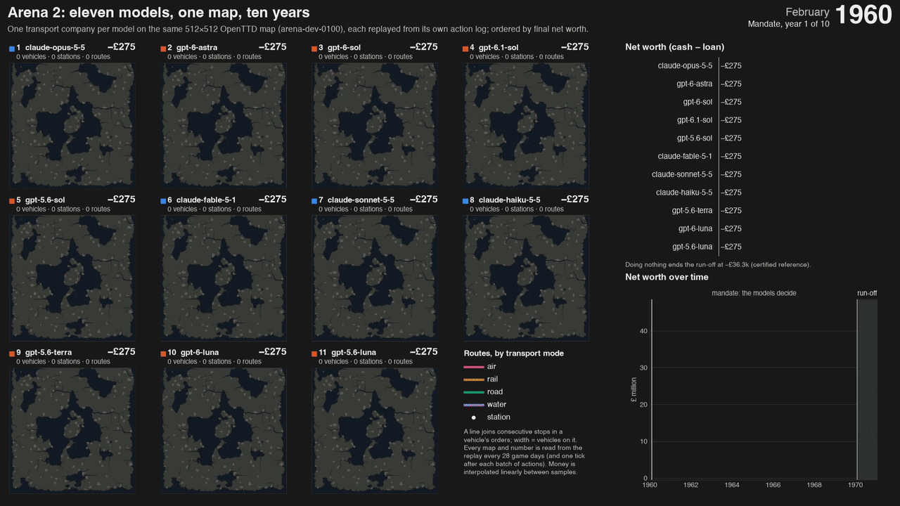

# Arena 2 timelapse

This document shows the timelapse of Arena 2 and tells you how to make it again.
The rules of Simplified Technical English are in [STE.md](STE.md).



## 1. What the timelapse shows

- Eleven models played the task `arena-dev-0100`. Each model has one map panel.
- The panels are in the order of the final net worth.
- A line connects two consecutive stops in the orders of a vehicle. The colour shows the transport mode. The width shows the number of vehicles on the route.
- The bars and the line chart show the net worth (cash minus loan) of each company.
- The shaded area of the line chart is the run-off year. The models make no decisions in the run-off year.

## 2. Files

| File | Contents |
|---|---|
| [video/arena2-timelapse-dark.mp4](video/arena2-timelapse-dark.mp4) | 60 seconds, 1920 x 1080, dark theme |
| [video/arena2-timelapse-light.mp4](video/arena2-timelapse-light.mp4) | 60 seconds, 1920 x 1080, light theme |
| [video/arena2-timelapse-15s-dark.mp4](video/arena2-timelapse-15s-dark.mp4) | 15 seconds, 1920 x 1080, dark theme |
| [video/arena2-timelapse-15s-light.mp4](video/arena2-timelapse-15s-light.mp4) | 15 seconds, 1920 x 1080, light theme |
| [video/arena2-timelapse-loop.webm](video/arena2-timelapse-loop.webm) | 15 seconds, 1280 x 720, loop |
| [img/arena2-timelapse.gif](img/arena2-timelapse.gif) | 15 seconds, 1280 x 720, loop for a web page |
| [img/arena2-timelapse-end-dark.png](img/arena2-timelapse-end-dark.png) | The last frame, dark theme |
| [img/arena2-timelapse-end.png](img/arena2-timelapse-end.png) | The last frame, light theme |

## 3. Where the data comes from

- Each frame comes from a replay of the action log of a player. No frame comes from an estimate.
- The replay reads the state of the world one time in each 28 game days, and one tick after each group of actions.
- A route appears at the first sample in which it is in the world.
- Money moves in a straight line between two samples. Thus, the money between two samples is an interpolation.
- The final net worth of each of the eleven replays is equal to the verified result in `docs/data/arena2.json`.
- A replay with no samples gives the same final checksum for each player. Thus, the samples do not change the game.

## 4. Limits

- Most of the construction occurs from 1960 to 1962. After 1966, almost only the money changes.
- A rail line or a road line is a straight line between two stops. It is not the real track. Some lines go across water.
- The vehicle count is the number of vehicles in service, not the number of vehicles that the player bought.

## 5. Make the timelapse again

1. Get the arena directory. It contains one directory for each player, with the action log of the player.
2. Do the replays and make the video:

   ```bash
   railhead timelapse <arena directory> --task tasks/arena-dev-0100 --out out/timelapse \
     --expected docs/data/arena2.json --title "Arena 2"
   ```

3. To make the video again from the saved samples, add `--render-only`.

CAUTION: The command needs the patched engine and `ffmpeg`.
